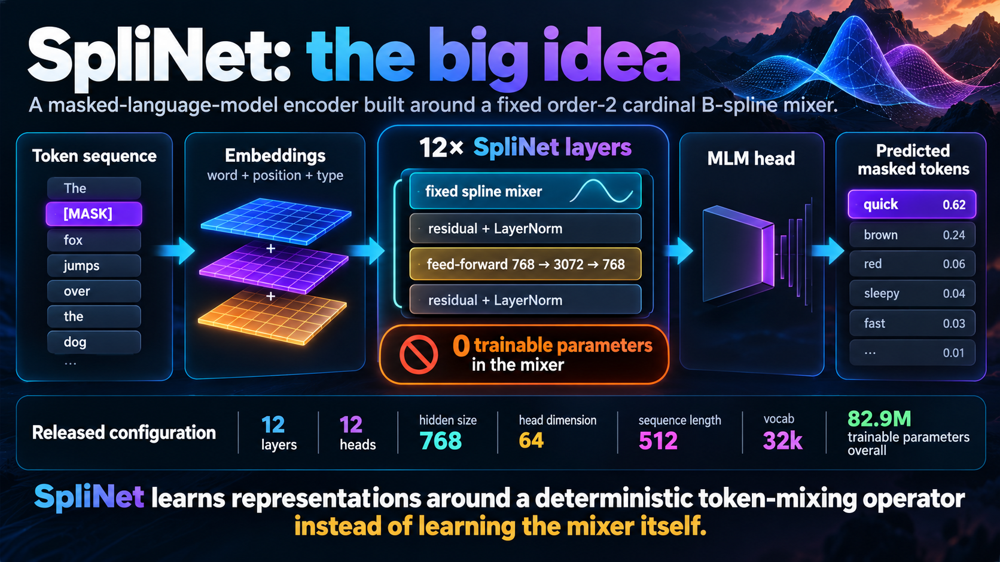
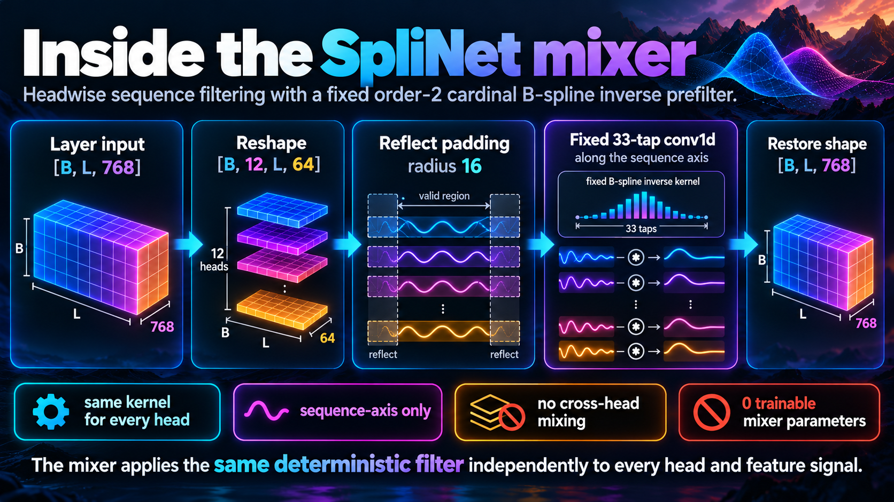
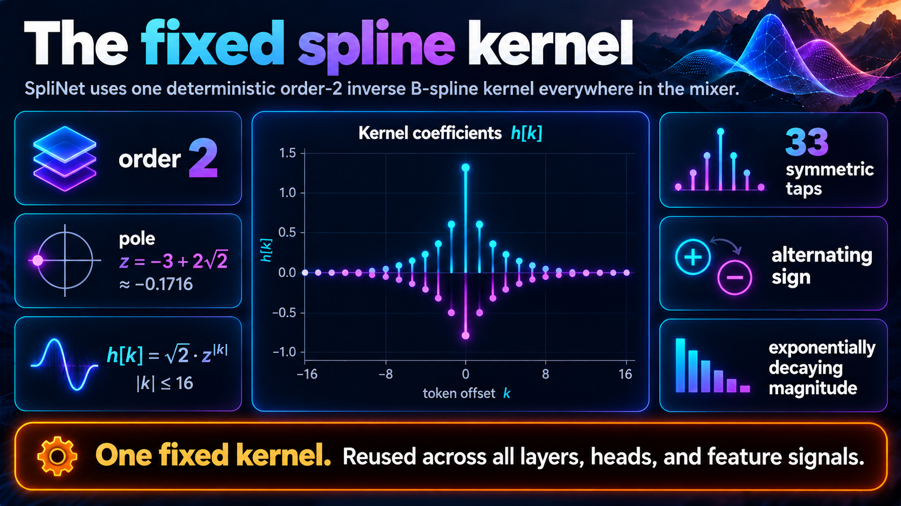
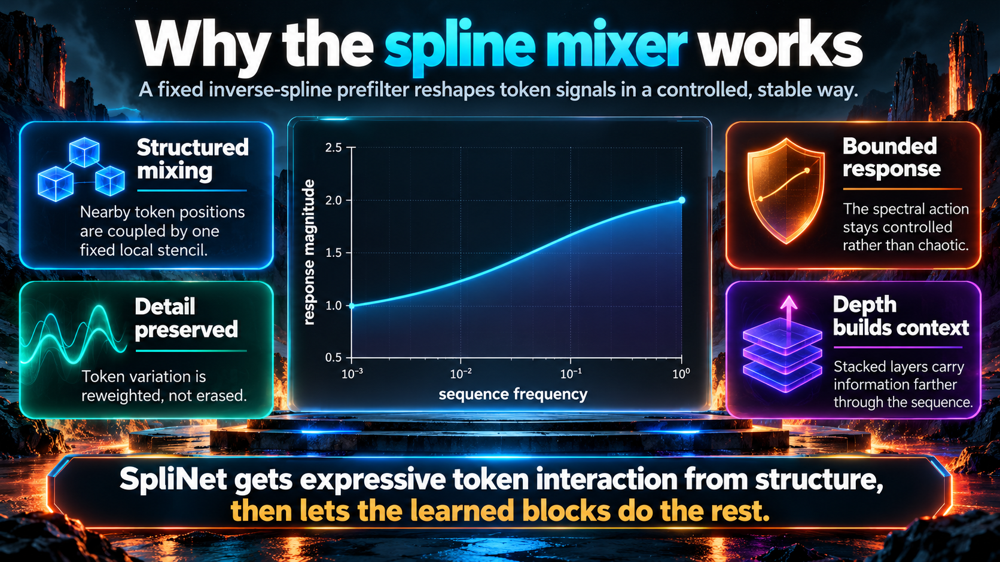
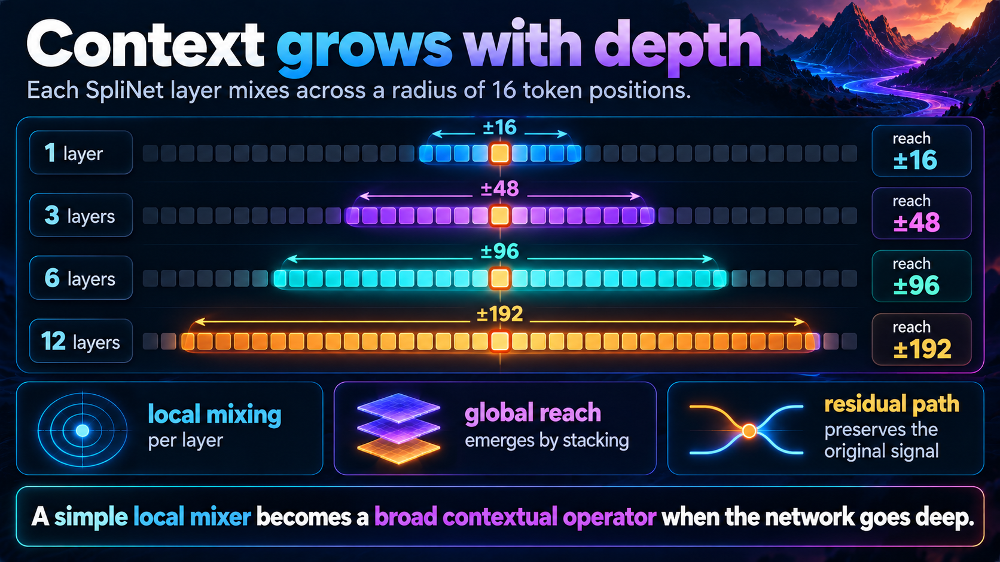
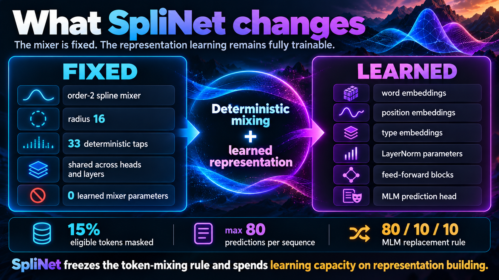

# SpliNet: Stop Learning the Mixer

## A fixed B-spline operator does the token mixing. The network learns everything around it.

SpliNet starts from an unusually simple question: **does the token mixer itself need to be learned?**

Its answer is no.

The released SpliNet encoder uses a **fixed, zero-parameter, order-2 cardinal B-spline inverse prefilter** as its token mixer. The mixer never changes during training. There are no learned mixer coefficients. There is no learned interaction rule hidden inside it. The network instead learns how to build useful representations *around* that deterministic operator.

That single decision is the point of SpliNet.



The released model has 12 layers, hidden size 768, 12 heads, head dimension 64, feed-forward width 3072, maximum sequence length 512, and a 32,000-piece vocabulary. The full model has about **82.9 million trainable parameters**. The spline mixer contributes exactly **zero** of them.

> **The mixer does not learn. The network learns how to use the mixer.**

## One SpliNet layer

A SpliNet layer is deliberately uncomplicated. The hidden representation first passes through the fixed spline mixer. That mixed signal is added back through a residual connection and normalized. A learned feed-forward block then expands the representation from 768 to 3072 dimensions, applies the nonlinearity, projects back to 768, and enters the second residual-normalization stage.

So each layer follows the pattern:

```text
input
  → fixed spline mixer
  → residual + LayerNorm
  → feed-forward 768 → 3072 → 768
  → residual + LayerNorm
```

The crucial point is where learning happens. **The token interaction rule is fixed. The nonlinear representation machinery is learned.**

## Inside the mixer

The input to the mixer has shape `[B, L, 768]`. SpliNet reshapes that hidden dimension into 12 groups of 64 features:

```text
[B, L, 768] → [B, 12, L, 64]
```

Nothing exotic happens after that. Every head-feature signal is treated as a one-dimensional sequence of length `L`. SpliNet applies the same fixed inverse-spline filter independently along that sequence axis.



The implementation then flattens all `B × 12 × 64` sequence signals into one batch, applies reflected padding with radius 16, performs one batched `conv1d`, and restores the original shape.

This matters because the word **multi-head** can easily suggest something more complicated than what is actually happening. The heads are simply a structured reshape for the sequence mixer. There is **no cross-head mixing inside the spline operator** and there are no different learned filters for different heads. Every head and every feature sees the same deterministic kernel.

After the mixer is restored to `[B, L, 768]`, the learned feed-forward block again operates on the full hidden representation. The model is therefore not twelve isolated streams. The separation applies specifically to the fixed spline-mixing step.

## The kernel is the architecture

The released SpliNet uses the stable pole

```text
z = -3 + 2√2 ≈ -0.1715728753
```

and the truncated inverse-filter kernel

```text
h[k] = √2 · z^|k|,    |k| ≤ 16
```

That gives a symmetric 33-tap filter from `k = -16` to `k = +16`.



Three properties matter immediately.

First, the pole has magnitude much smaller than one: `|z| ≈ 0.1716`. The coefficients therefore decay extremely fast away from the center. By offset 16, the coefficient magnitude is only about `8 × 10^-13`. So radius 16 is not an arbitrary-looking local window hiding a large discarded tail. For this kernel, it captures the practically relevant inverse-filter support extraordinarily well.

Second, the signs alternate. This is not a smoothing kernel. It is an **inverse-spline prefilter**: it reshapes the sequence signal so that the spline structure does not simply blur away variation.

Third, the same kernel is reused everywhere. It is not re-estimated at every layer, head, batch, or token position. The token-mixing law is part of the architecture itself.

## Why this can work

A fixed mixer sounds restrictive only if we assume that expressivity must come from the mixer. SpliNet makes a different allocation of responsibility.

The spline operator supplies **structured interaction across nearby token positions**. The learned parts of the network then decide what to do with that interaction.



The spectral behavior helps explain the choice. The radius-16 inverse-spline kernel has a smooth, bounded response that rises from roughly 1 at low sequence frequency toward roughly 2 at the high-frequency end. In plain language: the mixer does not flatten the sequence into a low-detail signal. It performs a controlled reweighting of sequence variation.

That controlled operator is followed immediately by a residual path and LayerNorm. The original representation therefore remains available while the mixed representation is injected into it, and the scale is normalized before the learned nonlinear block takes over.

This division of labor is the real SpliNet hypothesis:

**structure can provide the interaction; learning can provide the representation.**

The network does not need to spend parameters discovering a token-mixing stencil if a useful one can be built into the architecture from the start.

## Local mixing does not stay local

Each SpliNet layer has radius 16, so one layer directly couples a token to a local neighborhood. But the encoder stacks 12 such layers.

Repeated application expands the theoretical support of influence. Ignoring clipping at the ends of a finite sequence, the radius grows linearly with depth:

```text
1 layer   → ±16 positions
3 layers  → ±48 positions
6 layers  → ±96 positions
12 layers → ±192 positions
```



This is important conceptually. SpliNet does not need a single layer to perform every possible interaction. A local deterministic operation becomes a much broader contextual operator through composition.

And because every layer also contains a residual path, the architecture does not merely diffuse the signal outward. Each stage combines the original layer input with its spline-mixed neighborhood before the learned nonlinear transformation.

## What SpliNet actually learns

Freezing the mixer does **not** mean freezing the model.

The word embeddings are learned. The position embeddings are learned. The type embeddings are learned. The LayerNorm parameters are learned. Every feed-forward block is learned. The masked-language-model prediction head is learned.

Only the token-mixing law is fixed.



The training objective is standard masked-language modeling. Fifteen percent of eligible tokens are selected, with at most 80 prediction targets in a 512-token sequence, using the familiar 80/10/10 mask-random-unchanged replacement rule.

The gradient therefore changes the representation machinery surrounding the mixer, but **never changes the spline kernel itself**.

This creates a very clean architectural separation:

```text
FIXED
  token interaction geometry

LEARNED
  representation of tokens
  nonlinear feature transformation
  normalization scales and offsets
  prediction mapping
```

That separation is what makes SpliNet interesting. It asks whether learning capacity is better spent on representing information than on relearning the basic geometry through which token signals interact.

## One important naming detail: “single-sided” does not mean causal

The released configuration is described as **order-2, single-sided**. In the SpliNet implementation, “single-sided” means that the spline transform is applied **only along the sequence axis**.

It does **not** mean left-to-right causal filtering.

The actual released kernel is symmetric:

```text
h[-k] = h[k]
```

and reflected padding is used at the sequence boundaries.

That distinction matters because the implementation is an encoder for masked-language modeling, not a causal decoder.

## The implementation is almost brutally simple

At the center of SpliNet, the mixer reduces to the following logic:

```python
# x: [B, H, L, Dh]
y = x.permute(0, 1, 3, 2).reshape(B * H * Dh, 1, L)
y = reflect_pad(y, radius=16)
y = conv1d(y, fixed_order2_inverse_spline_kernel)
y = y.reshape(B, H, Dh, L).permute(0, 1, 3, 2)
```

That is the token mixer.

No learned coefficients are hiding elsewhere in it. The complexity is pushed out of the mixing rule and into the learned representation stack that surrounds it.

## Loading SpliNet

The public repository provides a builder for the released architecture:

```python
from splinet.builders import build_splinet

model = build_splinet(matched_to_fnet=False)
model.eval()
```

The released Hugging Face model is also packaged as a Transformers masked-language model with custom SpliNet code.

## The larger idea

SpliNet is not interesting because a spline appears inside a language model. The deeper idea is more general.

Neural architectures often treat every interaction mechanism as something to learn. SpliNet deliberately refuses to do that for token mixing. It puts a mathematically specified operator in the middle of the network, freezes it completely, and lets the surrounding learned layers adapt to it.

That gives the architecture a strong inductive bias without turning the whole model into a hand-designed signal-processing pipeline. The spline operation supplies a stable and structured way for neighboring token signals to interact. The learned embeddings and feed-forward blocks remain free to construct the representation required by the language objective.

The result is a clean question expressed directly in code:

> **What if token mixing is infrastructure rather than intelligence?**

SpliNet’s answer is to make the infrastructure deterministic—and spend the learning budget on everything that uses it.

---

### SpliNet resources

**GitHub:** https://github.com/AngshulMajumdar/SpliNet  
**Hugging Face:** https://huggingface.co/Angshul/SpliNet
